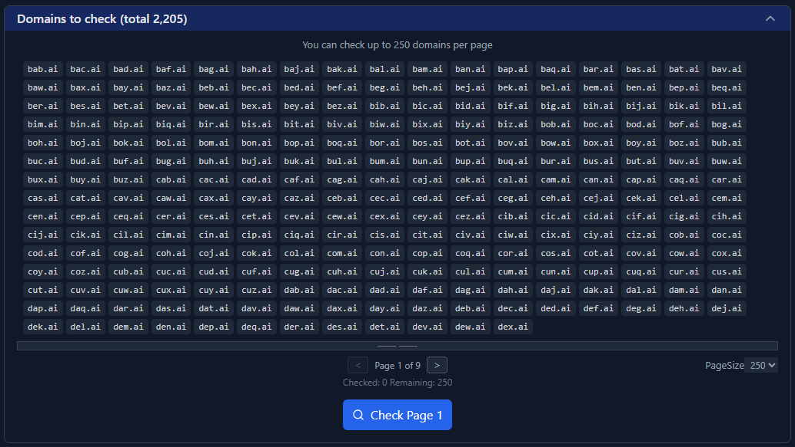
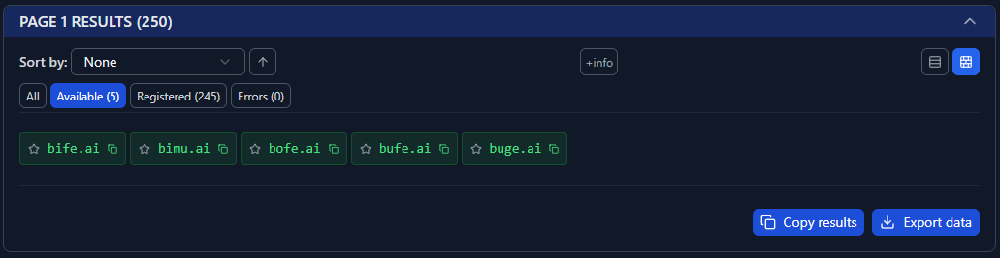

# Create pronounceable domain names with patterns

Not every good name is a dictionary word. Some of the most memorable brand names are invented: short combinations of letters that are easy to say, even if they don't mean anything yet.

But coming up with those names one at a time is difficult. What if, instead, you could describe **how a name should sound** and explore every letter combination that fits?

In this tutorial, we'll use **DDSL**, rdap.ai's built in domain language, to generate names from consonants and vowels, starting with just five and building up to thousands. Then we'll use [rdap.ai](https://rdap.ai/patterns) to check which domains may be available.

If you're new to DDSL, you can also start with [Your first domain pattern](/guides/first-domain-pattern/), which introduces combinations of ordinary words.

## Step 1: Think in terms of sounds

A simple way to invent names is to alternate **consonants** and **vowels**.

For example:

- **CVC** - consonant, vowel, consonant: *bat*, *len*, *mop*.
- **CVCV** - consonant, vowel, consonant, vowel: *melo*, *nori*, *tiga*.

These structures tend to produce names that are easier to attempt to pronounce than random strings of letters. They aren't a guarantee, though: spelling, language and individual letter combinations all affect how a word sounds.

We'll use the familiar `.ai` extension throughout, but the same patterns work with `.com`, `.io` or other extensions.

## Step 2: Start with five names

Let's fix the first and last letters and vary only the vowel in the middle:

```text
b[aeiou]m.ai
```

The square brackets mean **choose one character from this set**. Here, the choices are `a`, `e`, `i`, `o` and `u`.

That gives us exactly five domains:

```text
bam.ai
bem.ai
bim.ai
bom.ai
bum.ai
```

This is our first character class. Unlike the curly braces from the previous tutorial, which can select whole words or fragments, square brackets select **one character**.

## Step 3: Give the consonants some choices too

Now let's vary the consonants at each end:

```text
[bdf][aeiou][mn].ai
```

The first position has three choices (`b`, `d`, `f`), the middle has five vowels, and the last has two choices (`m`, `n`).

**3 × 5 × 2 = 30 domain names.**

The 30 generated results are:

```text
bam.ai
ban.ai
bem.ai
ben.ai
bim.ai
bin.ai
bom.ai
bon.ai
bum.ai
bun.ai
dam.ai
dan.ai
dem.ai
den.ai
dim.ai
din.ai
dom.ai
don.ai
dum.ai
dun.ai
fam.ai
fan.ai
fem.ai
fen.ai
fim.ai
fin.ai
fom.ai
fon.ai
fum.ai
fun.ai
```

Notice that some results sound more natural than others. That's fine. We're defining a *search space*, not asking the pattern to judge which names are good.

## Step 4: Use DDSL's built-in consonants and vowels

Typing a list of letters is useful when you want control over the result. But DDSL also has two shortcuts:

- `[:c:]` - any of the **21 consonants** (`b` through `z`, excluding vowels).
- `[:v:]` - any of the **5 vowels** (`a`, `e`, `i`, `o`, `u`).

So a complete three-letter consonant–vowel–consonant pattern is simply:

```text
[:c:][:v:][:c:].ai
```

There are 21 possibilities for the first letter, five for the second, and 21 for the third:

**21 × 5 × 21 = 2,205 domains.**

That's every CVC combination in this alphabet, expressed in one line. Some will be familiar words, some might sound like plausible new brands, and others will be awkward or unappealing.

[](/assets/images/pronounceable-cvc-pattern.png)

## Step 5: Make longer, word-like names

Let's add another consonant and vowel to get a four-letter **CVCV** structure:

```text
[:c:][:v:][:c:][:v:].ai
```

That gives **21 × 5 × 21 × 5 = 11,025 domains**. Names such as `melo.ai`, `nori.ai` and `tiga.ai` fit this structure.

Eleven thousand possibilities are a lot to check though. We can narrow the choice of consonants to letters we like the sound of:

```text
{b,d,f,g,l,m,n,r,s,t}[:v:]{b,d,f,g,l,m,n,r,s,t}[:v:].ai
```

That works, but it's a bit repetitive. DDSL lets us put a sequence inside parentheses and **repeat the entire group** using `{2}`:

```text
({b,d,f,g,l,m,n,r,s,t}[:v:]){2}.ai
```

This means: **choose one of ten consonants, choose a vowel, then do the same thing again**.

Now the search space is **(10 × 5) × (10 × 5) = 2,500 domains**.

Some examples from this pattern:

```text
baba.ai
bemo.ai
dima.ai
folo.ai
gina.ai
lora.ai
melo.ai
nori.ai
sara.ai
tiga.ai
```

You can change the consonants to favour different sounds, or narrow the vowel choices too. Small changes to the pattern can make a big difference to the character of the results.

## Step 6: Check them in rdap.ai

Generating names and checking their registration status are different jobs. **DDSL describes the names; rdap.ai checks them.**

Open [rdap.ai/patterns](https://rdap.ai/patterns) and paste in the 2,500-name pattern from Step 5:

```text
({b,d,f,g,l,m,n,r,s,t}[:v:]){2}.ai
```

Generate the names and then run the availability check. You can inspect available and registered results, and any names that couldn't be checked. Depending on the domain and the settings you use, you may also see information indicating that a registered domain is for sale.

A larger search may be divided into pages and take time to check. For this example we checked the first 250 and found 5 available (at time of writing!):

[](/assets/images/available-pronounceable-domain-results.png)

Then curiosity got the better of us and we checked all 2500 domains in one go using Pro (up to 5000 domains per page):

[](/assets/images/all-pronounceable-domain-results.png)

## Pronounceable isn't the same as desirable

It's worth remembering what the pattern does - and what it doesn't.

A CVC or CVCV structure makes a name *more likely* to be pronounceable, but it doesn't guarantee a pleasing sound, a memorable brand or an available domain. Some combinations will be clumsy. Others may already be words, names or trademarks.

That's why I like combining systematic generation with human judgement: **use patterns to explore the possibilities, rdap.ai to check availability, and your own ears to choose what sounds right**. Before using a name commercially, check for existing brands and trademarks as well as domain availability.

## Try a small challenge

Can you describe a set of exactly **500 four-letter CVCV domains**?

One way is to choose five consonants and five vowels for each consonant–vowel pair, then repeat the pair twice - but that gives 625. Try changing the number of choices in just one position to reach 500.

You now know enough to construct the pattern yourself.

**The bigger idea:** you don't have to invent every possible name. You can define what a plausible name *looks like*, generate the whole set, and spend your time evaluating the results.

[Try a pronounceable-name pattern on rdap.ai](https://rdap.ai/patterns) · [Explore the full DDSL reference](https://ddsl.app/) · [Read the DDSL specification](https://github.com/mrpling/ddsl/blob/main/spec.md)
