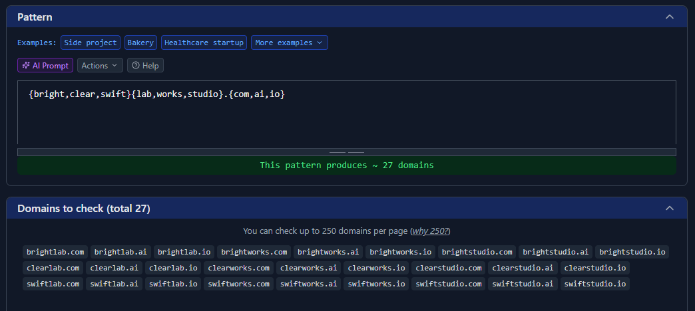
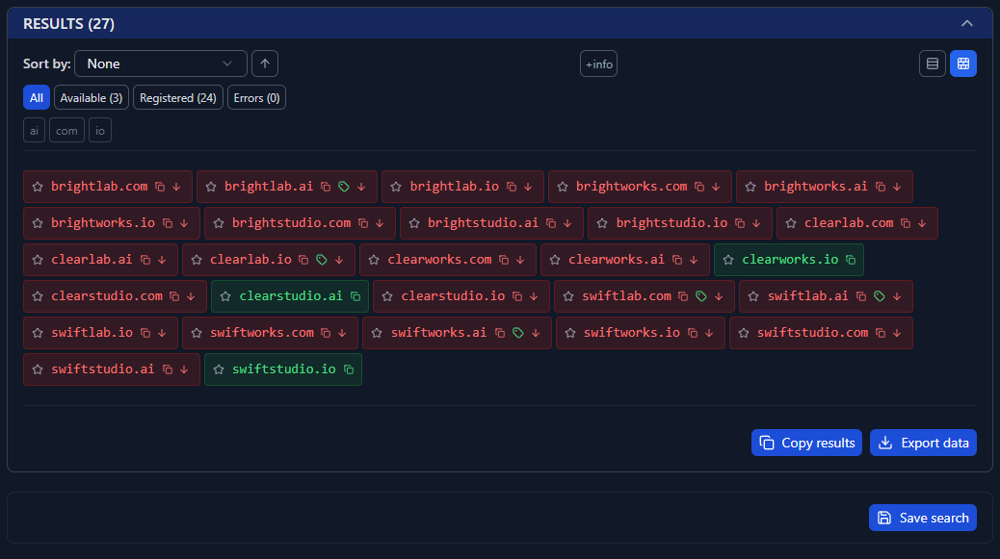

# Your first domain pattern: from one idea to 27 names

Looking for a domain name usually begins with an idea. Perhaps you have a name in mind, you check whether it's available, and then you try another. And another.

But what if you could describe *all the variations you want to explore* in one line, rather than typing them individually?

That's the idea behind **domain patterns**. In this guide, we'll start with a single domain and build a pattern that generates 27 different names. You don't need to know regular expressions or write any code.

We'll use **DDSL**, the pattern language supported by [rdap.ai](https://rdap.ai/). You can read its [full reference](https://ddsl.app/) later; for now, you only need one simple feature.

## Step 1: Start with one name

Suppose you're considering the name **Bright Lab** for a new project. Your starting point might be:

```text
brightlab.com
```

This is already a valid DDSL expression. It describes exactly one domain name.

Nothing particularly exciting yet, but every pattern starts somewhere.

## Step 2: Give yourself some choices

Perhaps you like *Bright*, but you're also considering *Clear* and *Swift*.

Put those alternatives inside curly braces, separated by commas:

```text
{bright,clear,swift}lab.com
```

This generates three names:

```text
brightlab.com
clearlab.com
swiftlab.com
```

The braces simply mean **choose one of these alternatives**. DDSL generates every possibility you've described.

## Step 3: Combine two sets of words

Now suppose *Lab* isn't the only ending you like. You might also consider *Works* or *Studio*.

Add a second set of alternatives:

```text
{bright,clear,swift}{lab,works,studio}.com
```

You now have three choices for the first part and three for the second: **3 × 3 = 9 domain names**.

```text
brightlab.com
brightworks.com
brightstudio.com
clearlab.com
clearworks.com
clearstudio.com
swiftlab.com
swiftworks.com
swiftstudio.com
```

This is the useful part: you haven't written nine names, just **one expression describing all nine**. No combination is accidentally missed.

## Step 4: Explore more than one extension

You might want to check `.com`, `.ai` and `.io` rather than deciding on an extension at the outset.

The same idea works after the dot:

```text
{bright,clear,swift}{lab,works,studio}.{com,ai,io}
```

That gives you **3 × 3 × 3 = 27 domain names**.

```text
brightlab.com
brightlab.ai
brightlab.io
brightworks.com
brightworks.ai
brightworks.io
brightstudio.com
brightstudio.ai
brightstudio.io
clearlab.com
clearlab.ai
clearlab.io
clearworks.com
clearworks.ai
clearworks.io
clearstudio.com
clearstudio.ai
clearstudio.io
swiftlab.com
swiftlab.ai
swiftlab.io
swiftworks.com
swiftworks.ai
swiftworks.io
swiftstudio.com
swiftstudio.ai
swiftstudio.io
```

[](/assets/images/first-domain-pattern-generated.png)

## Step 5: Check the domains in rdap.ai

Generating names and checking whether they are registered are two different things. DDSL creates the list; **rdap.ai checks the domains**.

Open [rdap.ai/patterns](https://rdap.ai/patterns) and paste in the expression from Step 4:

```text
{bright,clear,swift}{lab,works,studio}.{com,ai,io}
```

The generated names will appear automatically where it says **Domains to check**. You'll notice that if you make changes to the pattern the generated names will also change. Now run the availability check by clicking:

.

You can inspect which domains are available, which are registered and which could not be checked successfully. Where supported, rdap.ai may also show information suggesting that a registered domain is for sale.

**Don't assume a generated domain is available.** The pattern gives you possible names; the lookup gives you the current response from the registry (the org that runs that extension e.g. Verisign for .com). Results can change, and some registries limit how quickly they can be checked.

[](/assets/images/first-domain-pattern-results.png)

## Step 6: Refine the pattern

The first set of results is a starting point, not the end of the search.

Perhaps *Studio* feels too long, or you want to try *Nova* as another opening word. Change the expression and the generated domains will change:

```text
{bright,clear,swift,nova}{lab,works,hub}.{com,ai,io}
```

Now there are **4 × 3 × 3 = 36 combinations**.

This is where patterns become useful for real naming work. You can expand or narrow the space, compare the possibilities and explore a whole family of names without repeatedly starting from scratch.

## Bonus: Make longer patterns easier to read

As your ideas grow, you can give the different parts names using **variables**. For example:

```text
@prefix = {bright,clear,swift,nova}
@suffix = {lab,works,hub}
@tld = {com,ai,io}

@prefix@suffix.@tld
```

This produces the same 36 combinations as the previous example. It's a little longer, but easier to update: you can change the prefix list, suffix list or extensions independently.

You don't need variables for your first pattern. They're simply a useful next step when expressions get more ambitious.

## The bigger idea

A conventional domain search begins with a name and asks whether it is available.

A pattern begins with a **space of possible names**, generates every combination you've specified, and lets you investigate the results.

Today we went from one domain to 36 with a few braces and commas. The same approach can describe hundreds or even thousands of names.

[Try your own pattern at rdap.ai/patterns](https://rdap.ai/patterns) 
