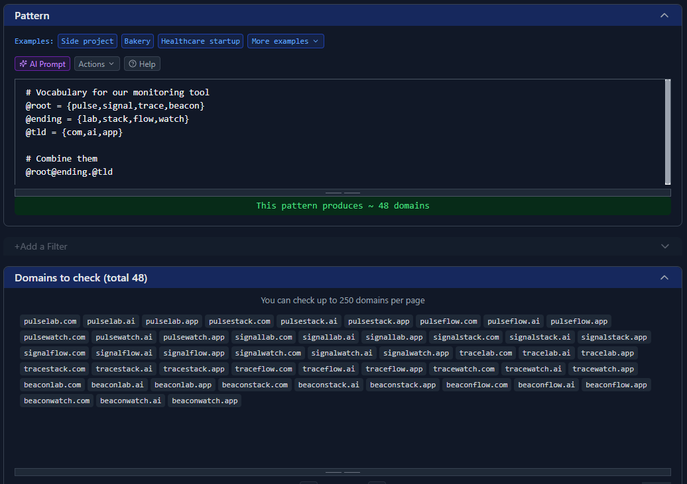
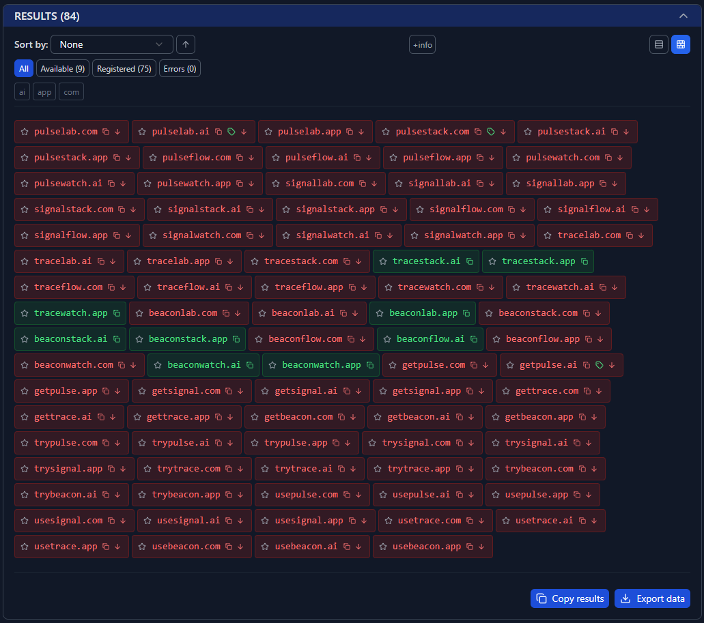

# Explore a naming space systematically

**Stop searching for individual names. Start exploring entire naming spaces.**

When you're trying to name something, it's easy to fall into a familiar routine: think of a name, check it, discover it's taken, and think of another. The problem isn't a shortage of ideas. It's that you have no clear picture of what you've explored or what you might have missed.

A domain pattern offers another approach. You decide which combinations you're interested in, describe them once, and then check the entire set.

In the [first tutorial](/guides/first-domain-pattern/), we combined words to generate domains. In the [second](/guides/pronounceable-domain-names/), we invented names using consonant and vowel patterns. Now let's use those ideas to tackle a naming problem systematically.

## Step 1: Start with a naming brief

Imagine we're naming a developer tool that monitors services and alerts you when something needs attention.

We like four words that suggest what it does:

- **pulse** - health and activity
- **signal** - detecting something important
- **trace** - following what happened
- **beacon** - visibility and alerts

And we like four possible endings: **lab**, **stack**, **flow** and **watch**.

We also want to explore `.com`, `.ai` and `.app`.

We could type each combination manually. But instead, we're going to describe the *whole naming space*: every combination of those roots, endings and extensions.

This doesn't mean we're exploring every possible name for a monitoring product. We're deliberately drawing a boundary around the names we'd actually consider.

## Step 2: Give the building blocks names

DDSL (the domain language built into rdap.ai) lets us define reusable variables in a document. A variable begins with `@`, followed by its name and a definition.

```text
# Vocabulary for our monitoring tool
@root = {pulse,signal,trace,beacon}
@ending = {lab,stack,flow,watch}
@tld = {com,ai,app}

# Combine them
@root@ending.@tld
```

Each variable contains a set of alternatives. The final line uses them to construct a domain name: one root, one ending and one extension.

For example, the pattern can produce:

```text
pulselab.com
pulseflow.ai
signalwatch.app
tracestack.com
beaconlab.ai
beaconwatch.app
```

There are four roots, four endings and three extensions, giving us:

**4 × 4 × 3 = 48 distinct domains.**

Here's the idea visually:

```text
{pulse, signal, trace, beacon}
               ×
 {lab, stack, flow, watch}
               ×
       {com, ai, app}
               ?
       48 domain names
```

[Open rdap.ai's pattern tool](https://rdap.ai/patterns), paste the document and look at the generated names. Notice that changing just one variable updates every relevant combination.

[](/assets/images/naming-space-pattern-editor.png)

## Step 3: Try a second naming strategy

Not every promising name follows the same structure. What about shorter names that put an action in front of our root word - like `getpulse.com` or `trysignal.ai`?

We can add another variable and another expression to the same document:

```text
@root = {pulse,signal,trace,beacon}
@ending = {lab,stack,flow,watch}
@prefix = {get,try,use}
@tld = {com,ai,app}

# Strategy 1: root + ending
@root@ending.@tld

# Strategy 2: prefix + root
@prefix@root.@tld
```

The first strategy produces **48 domains**, as before. The second produces **3 × 4 × 3 = 36 domains**.

Some examples from the second strategy:

```text
getpulse.com
getbeacon.ai
trysignal.app
trytrace.com
usesignal.ai
usebeacon.app
```

DDSL combines the results of both expressions into a single set and removes duplicates. In this example the two strategies don't overlap, so we have **48 + 36 = 84 distinct domains**.

The comments beginning with `#` help us remember what each expression is for; they don't generate domains themselves. And the variable definitions can be reused by as many expressions as we like.

## Step 4: Know what you've searched - and what you haven't

This is where systematic searching becomes useful.

Our document defines **84 specific domain names**. We can generate that same set again tomorrow, share the pattern, or revise one part of it without having to remember which names we typed last time.

Importantly, the number 84 isn't a guess or a sample. It's the complete set of distinct names described by our chosen expressions.

But *complete* needs a qualification: we haven't searched every possible monitoring-tool name. We've searched every name **within the boundaries we chose**. We left out other roots, endings, prefixes and extensions on purpose.

And generating all 84 names doesn't mean we've checked their availability yet. That's a separate step.

## Step 5: Check the space with rdap.ai

Paste the full document from Step 3 into [rdap.ai/patterns](https://rdap.ai/patterns). The generated names appear in the **Domains to check** area. Run the availability check to look them up.

You can then investigate which domains are reported as available, which are registered, and which could not be checked successfully. Depending on the domain and your settings, registered results may also show an explicit or inferred for-sale signal.

[](/assets/images/naming-space-results.png)

There's a useful distinction here:

- **Complete generation** means DDSL has produced every domain matching the pattern.
- **Complete checking** means every intended lookup has returned a usable result.

Registry rate limits, network errors or unsupported lookups can leave some names unresolved. A name shown as unregistered by RDAP may also be reserved or otherwise unavailable to register. Treat the lookup results as evidence to investigate, not a guarantee you can buy a name.

## Step 6: Refine the space, not just the shortlist

Perhaps the first set makes us realise that **beacon** is too long, or that **flow** works better than **watch**. Or maybe we want to compare more `.ai` names without abandoning `.com`.

Instead of typing fresh lists, change the variables and generate the revised set.

For example, we can replace the roots and endings while keeping the two naming strategies:

```text
@root = {pulse,signal,trace,scope}
@ending = {lab,stack,flow,hub}
@prefix = {get,try,use}
@tld = {com,ai,app}

@root@ending.@tld
@prefix@root.@tld
```

That's still **84 distinct domains**, but it's a different, deliberately refined search space. We haven't just added random suggestions; we've updated the rules of the search.

If you have Rdap Pro which has the save searches and favorites features, they're useful for keeping promising results and returning to your research. Exporting results is also useful here for taking the work outside Rdap.ai and into other workflows. The DDSL document itself is worth keeping, too: it's the recipe for reproducing the whole set. 

## Step 7: Scale up, but keep your boundaries useful

What happens if we expand to eight roots, six endings, three prefixes and four extensions?

Our two strategies would describe:

- Root + ending: **8 × 6 × 4 = 192 domains**
- Prefix + root: **3 × 8 × 4 = 96 domains**

Assuming the two strategies don't generate any identical names, that's **288 distinct domains** - still an entirely manageable, clearly defined space.

You can go much larger, but bigger isn't automatically better. A well-chosen set of 300 names may be far more useful than 20,000 combinations you wouldn't seriously consider.

The aim isn't to generate the largest possible list. It's to **explore a meaningful set completely**, understand the results and make better decisions.

## Try it yourself

Here's a challenge. Imagine you're naming a photography business or app.

Choose some words associated with **light, colour, images or lenses**. Define at least two naming strategies using DDSL variables, and aim for a space of **100 to 500 domains**.

Then check the generated domains and choose your five favourites. Can you explain exactly which naming possibilities you included - and which you deliberately excluded?

That's systematic naming research: not hoping the next idea is the one, but understanding the space you've decided to explore.

[Try it in rdap.ai](https://rdap.ai/patterns) · [Read the DDSL reference](https://ddsl.app/) · [Read the open DDSL specification](https://github.com/mrpling/ddsl/blob/main/spec.md)
