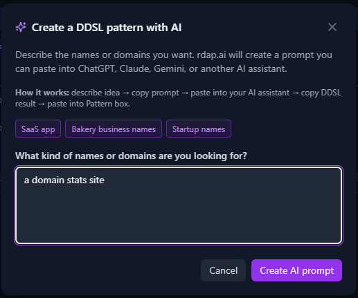
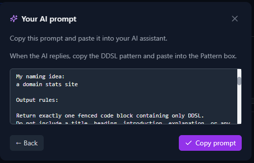
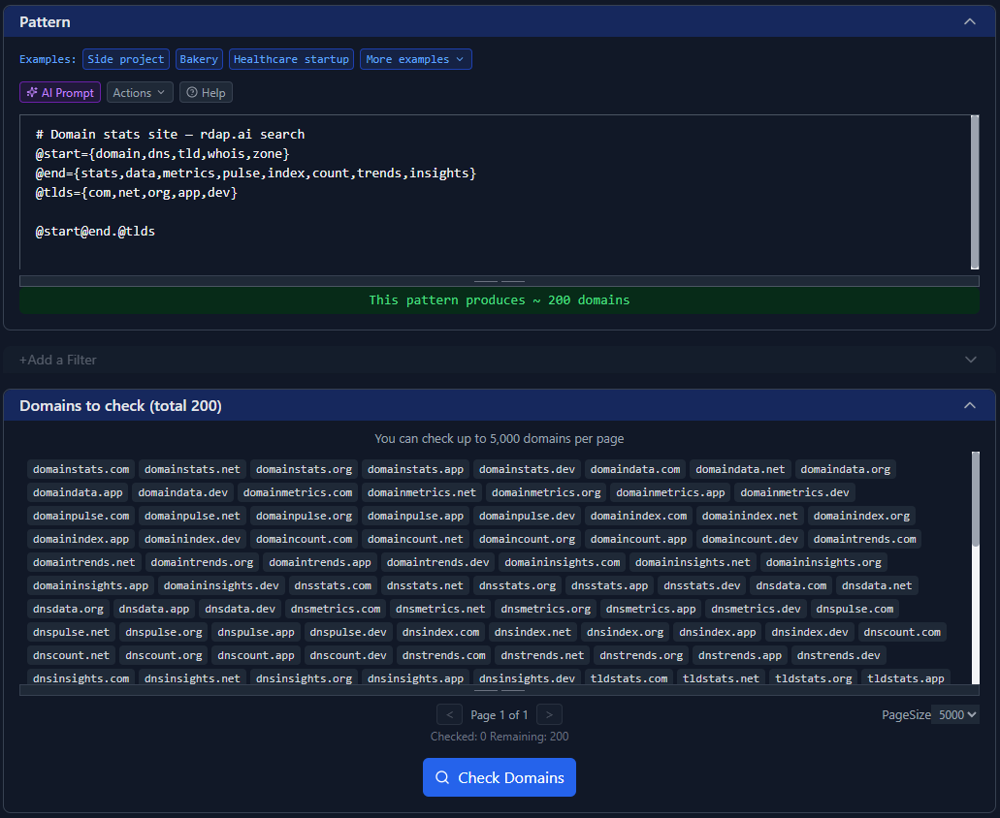
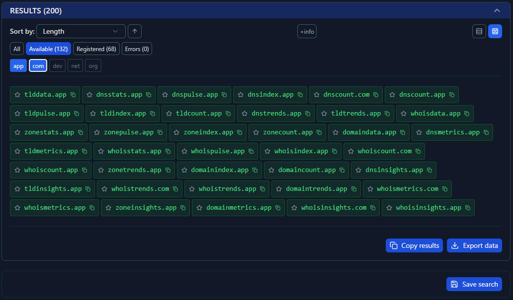

# Create domain patterns with AI

You don't need to know DDSL to start using domain patterns.

If you can describe the kinds of names you're looking for, an AI assistant can help turn that description into a pattern. And once you have the pattern, [rdap.ai](https://rdap.ai/patterns) can generate the matching domain names and check them against the registries.

The process has three distinct parts:

1. **rdap.ai** prepares a prompt from your naming idea.
2. **An AI assistant** uses that prompt to write DDSL.
3. **rdap.ai** generates the domains described by the DDSL and checks their status.

This guide walks through the process using a simple example: finding a name for a domain statistics website.

If you've followed the earlier tutorials, you'll recognise some of the DDSL syntax. If not, that's fine: the point of this feature is to help you get started without learning the language first.

## Step 1: Describe the names you want

Open [rdap.ai's Patterns area](https://rdap.ai/patterns) and choose **AI Prompt** to open **Create a DDSL pattern with AI**.

The dialog asks a straightforward question:

**What kind of names or domains are you looking for?**

You can use one of the example suggestions, or type your own. For our first attempt, let's keep it simple:

```text
a domain stats site
```

That's enough to get started. There's no need to write DDSL here or devise a complex prompt yourself.

[](/assets/images/ai-pattern-prompt-dialog.png)

## Step 2: Let rdap.ai build the AI prompt

Select **Create AI prompt**.

rdap.ai doesn't generate the names with an AI model at this stage. Instead, it prepares a detailed prompt that you can copy into an AI assistant such as ChatGPT, Claude or Gemini.

The generated prompt does more than repeat your request. It tells the assistant:

- what DDSL is and what the result should contain;
- where to find the [DDSL guide](https://ddsl.app/llms.txt) and [TLD reference](https://ddsl.app/tlds.txt);
- which syntax rules to follow if those references aren't accessible;
- to produce a concise DDSL document, rather than a list of guessed domain names;
- not to invent TLDs or claim that names are available.

It also asks the assistant to return **one copyable code block containing only DDSL**. That makes the result easy to transfer back to rdap.ai.

You don't need to read or edit the full prompt unless you want to. The application has assembled those instructions for you.

[](/assets/images/ai-generated-prompt.png)

## Step 3: Ask your AI assistant

Copy the generated prompt, open your preferred AI assistant, and paste it into a conversation.

The assistant should respond with a DDSL document. The exact result will vary depending on the assistant and how it interprets your idea.

For our **domain stats site** example, we used Claude and this was its first response:

```text
# Domain stats site — rdap.ai search
@start={domain,dns,tld,whois,zone}
@end={stats,data,metrics,pulse,index,count,trends,insights}
@tlds={com,net,org,app,dev}

@start@end.@tlds
```
The expression combines five start words, eight end words and five extensions : **5 × 8 × 5 = 200 possible domain names**.

Notice what the AI has given us: **a rule for generating names**, not a handful of individual suggestions. We can inspect, change and reuse that rule.

And the assistant has not checked whether any of those domains can be registered. That's the next part of the workflow.

## Step 4: Paste the DDSL into rdap.ai

Copy the DDSL code from the assistant's response. Return to [rdap.ai/patterns](https://rdap.ai/patterns) and paste it into the pattern editor.

rdap.ai expands the document into its complete set of domain names. For the example above, the generated count should be **200**.

Take a moment to check the output:

- Do the domains follow the naming style you intended?
- Are the extensions the ones you wanted?
- Is the number of generated names manageable?
- Does the editor accept the DDSL without errors?

AI-generated DDSL is still code. It can contain mistakes, unsuitable combinations or syntax that needs adjusting. The pattern editor is the place to check what it *actually* generates.

[](/assets/images/ai-pattern-generated-domains.png)

## Step 5: Check the domain names

Generating 200 domains is not the same as checking their registration status.

Use rdap.ai's availability check to query the registries for the generated names. You can then investigate which are reported as registered, which appear unregistered, and which could not be checked successfully.

Depending on the domain and your settings, registered results may also display for-sale information.

A failed lookup isn't evidence that a domain is available, and even an unregistered domain can be reserved or otherwise unavailable for registration. As with any domain research, treat the results as information to verify before making a purchase decision.

[](/assets/images/ai-pattern-checked-results.png)

## Step 6: Improve the idea and try again

Your first prompt doesn't have to be perfect. Often the quickest way to improve the names is to be more specific about what you want.

For example, instead of *a domain stats site*, you might ask for:

```text
A name for a website that researches domain registrations
and registry statistics. Combine short words related to
names, domains, data and discovery. Prefer clear, memorable
combinations in .com and .net. Keep the set under 100 names.
```

This gives the assistant more direction about the subject, style, extensions and scale of the search.

You have two ways to refine the result:

- **Ask the AI again.** Change your description in rdap.ai, generate a new prompt and use it with your assistant.
- **Edit the DDSL yourself.** If you like the structure, changing a few words or extensions in the pattern editor may be faster than starting again.

For example, in our earlier result, changing just the variable

```text
@end={stats,data,metrics,pulse,index,count,trends,insights}
```

to

```text
@end={stats,data,metrics,pulse,index,count,watch,scope}
```

changes the entire set of generated combinations without needing to type out any individual domains.

That's one of the most useful things about DDSL: **the pattern remains yours to inspect and revise** after the AI has helped create it.

## AI for ideas, DDSL for precision, RDAP for checking

Each part of this process does something different:

- **AI** helps translate a loosely described naming idea into a structured expression.
- **DDSL** defines a finite, reproducible set of domain names.
- **rdap.ai** expands that set and checks the domains against their registries.

The AI doesn't need to invent a list of supposedly available names, and rdap.ai doesn't need to guess what you mean by a good brand name. You remain in control of the search space.

It's also worth remembering that no pattern or AI assistant can judge every aspect of a name. Pronunciation, meaning, trademarks and suitability for your project still need human judgement and, where appropriate, further research.

## Try it yourself

Think of a project you've considered naming — a side project, business, app or website. Describe it in one or two sentences, use **Create AI prompt**, and see what DDSL your assistant produces.

Then go back and change your description. Does a more specific brief produce a better set of names?

**[Create a domain pattern with AI in rdap.ai](https://rdap.ai/patterns)**

If you'd like to understand more about what the AI produces, the earlier guides explain the underlying ideas:

- [Your first domain pattern](/guides/first-domain-pattern/)
- [Create pronounceable domain names](/guides/pronounceable-domain-names/)
- [Explore a naming space systematically](/guides/explore-a-naming-space/)

For the full language reference, see [ddsl.app](https://ddsl.app/).
